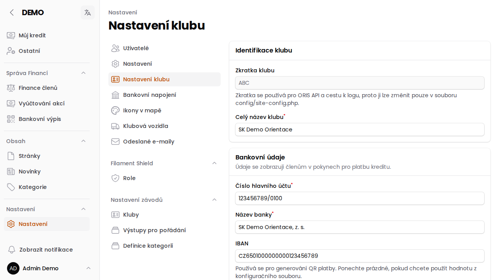

# Nastavení klubu

Stránka **Nastavení → Nastavení klubu** (`/admin/config/club`) obsahuje základní identifikaci vašeho oddílu a
bankovní údaje, které se zobrazují **členům v pokynech k platbě kreditu**.

## Identifikace klubu

- **Zkratka klubu** — používá se pro ORIS API a v cestě ke konfiguraci; needitovatelná přímo tady (jen v
  `config/site-config.php` na serveru).
- **Celý název klubu** — oficiální název; zobrazuje se na veřejném webu, ve výsledcích vyhledávačů a jako
  odesílatel v patičce e-mailů.
- **Krátký název klubu** — nepovinný neformální název (např. „ABM Brno“), který se zobrazuje v hlavičce
  e-mailů. Pokud ho nevyplníte, použije se celý název klubu.

## Barvy klubu

Sekce **Barvy klubu** určuje vzhled e-mailů, které aplikace rozesílá členům.

- **Akcentní barva** — barva ve formátu `#rrggbb` (např. `#0a7d3b`). Použije se na pruh v hlavičce e-mailu, hlavní tlačítko a zvýraznění termínů. Pokud pole nevyplníte, použije se výchozí žlutá `#ffd329`.

Barvu textu na tlačítku (tmavá nebo bílá podle jasu barvy) i světlé odstíny pozadí aplikace dopočítá sama.

:::tip{title="Logo a sociální sítě v e-mailech"}
Logo klubu v hlavičce a odkazy na sociální sítě v patičce se přebírají ze sekce **Veřejný web a sociální sítě** níže. Stačí je vyplnit tam.
:::

## Veřejný web a sociální sítě

Sekce **Veřejný web a sociální sítě** obsahuje údaje pro vyhledávače (SEO) a pro náhledy odkazů sdílených na sociálních sítích.

- **Popis klubu** — jedna až dvě věty o klubu, ideálně do 160 znaků. Zobrazuje se ve výsledcích vyhledávání a v náhledech odkazů u stránek bez vlastního popisu.
- **Výchozí obrázek pro sdílení** — JPG nebo PNG ve velikosti 1200 × 630 px (např. logo na barvách klubu). Použije se v náhledu odkazu na Facebooku, WhatsAppu apod. u stránek bez vlastního obrázku.
- **Logo klubu** — čtvercové PNG nebo JPG, alespoň 112 × 112 px. Vyhledávače ho mohou zobrazit u výsledků klubu.
- **Favicona** — malá ikona webu v záložce prohlížeče a v záložkách (administrace i veřejný web). Soubor ICO nebo čtvercové PNG (např. 48 × 48 px), nejvýše 512 kB. Formát SVG se nepodporuje. Po nahrání nového souboru se starý automaticky smaže. Pokud ikonu nenahrajete, použije se výchozí ikona DaLinu.
- **Profily na sociálních sítích** — celé adresy profilů klubu (Facebook, Instagram, Strava…). Každou potvrďte klávesou Enter. Logo a profily se zobrazují i v e-mailech.

:::tip{title="Vyplňte po aktualizaci"}
Po přechodu na novou verzi tyto údaje vyplňte, jinak budou mít veřejné stránky bez vlastního popisu a obrázku jen obecné náhledy. Podrobnosti k nastavení u novinek a stránek najdete v částech [Novinky](/napoveda/sprava-novinek) a [Statické stránky](/napoveda/sprava-stranek).
:::

## Bankovní údaje

- **Číslo hlavního účtu**, **Název banky**, **IBAN** — použité pro generování QR platby na stránce
  [Finance](/napoveda/stranka-finance). IBAN lze nechat prázdný, pokud chcete použít hodnotu z konfiguračního
  souboru.

:::info{title="Nezaměňujte s Kluby"}
Tahle stránka nastavuje **váš vlastní** klub. Pod Nastavení najdete i položku **[Kluby](/napoveda/kluby)** — to je
sdílený číselník *všech* oddílů (pro párování se závodníky/závody z jiných klubů), ne nastavení vašeho oddílu.
:::
